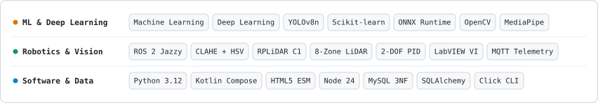
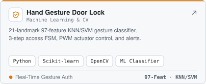
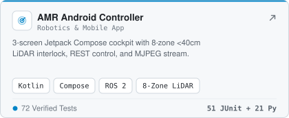
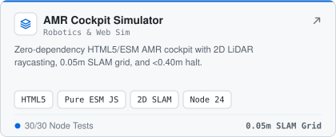
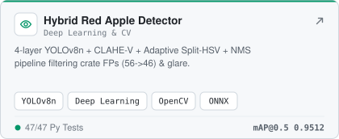
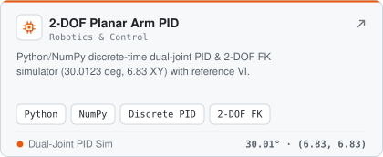
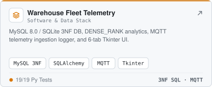
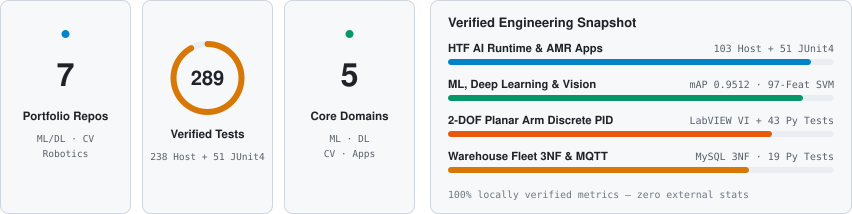

## Hi, I'm Tín Nguyễn

**Applied AI & Robotics Developer** — building machine learning, deep learning, computer vision, and autonomous robot systems from perception to motion control.

`Vietnam` · Focused on Applied AI, Machine Learning, Deep Learning, Computer Vision, Robotics & Software

### Overview / Tổng quan

This GitHub profile presents 6 end-to-end engineering projects across **Applied AI**, **Machine Learning**, **Deep Learning**, **Computer Vision**, **Robotics**, and **Software** engineering. Each linked repository ships runnable source code, calibrated datasets, and measured system benchmarks.

Hồ sơ GitHub này giới thiệu 6 dự án kỹ thuật hoàn chỉnh trong các lĩnh vực **Applied AI**, **Machine Learning** (máy học), **Deep Learning** (học sâu), **Computer Vision** (thị giác máy tính), **Robotics** và **Software** (kỹ thuật phần mềm). Mỗi kho lưu trữ đều đi kèm mã nguồn chạy thực tế, bộ dữ liệu chuẩn hóa và các chỉ số kỹ thuật đo được từ hệ thống.

### Tech Stack / Công nghệ cốt lõi

  <picture>
    <source media="(prefers-color-scheme: dark)" srcset="./assets/tech-stack-dark.svg">
    <source media="(prefers-color-scheme: light)" srcset="./assets/tech-stack-light.svg">
    
  </picture>

### Architecture & Featured Repositories / Kiến trúc & Dự án nổi bật

  <a href="https://github.com/Yin1090/hand-gesture-smart-door-lock">
    <picture>
      <source media="(prefers-color-scheme: dark)" srcset="./assets/card-hand-gesture-smart-door-lock-dark.svg">
      <source media="(prefers-color-scheme: light)" srcset="./assets/card-hand-gesture-smart-door-lock-light.svg">
      
    </picture>
  </a>
  <a href="https://github.com/Yin1090/amr-android-controller">
    <picture>
      <source media="(prefers-color-scheme: dark)" srcset="./assets/card-amr-android-controller-dark.svg">
      <source media="(prefers-color-scheme: light)" srcset="./assets/card-amr-android-controller-light.svg">
      
    </picture>
  </a>
  <a href="https://github.com/Yin1090/amr-cockpit-simulator">
    <picture>
      <source media="(prefers-color-scheme: dark)" srcset="./assets/card-amr-cockpit-simulator-dark.svg">
      <source media="(prefers-color-scheme: light)" srcset="./assets/card-amr-cockpit-simulator-light.svg">
      
    </picture>
  </a>
  <a href="https://github.com/Yin1090/hybrid-yolov8-hsv-red-apple-detection">
    <picture>
      <source media="(prefers-color-scheme: dark)" srcset="./assets/card-hybrid-yolov8-hsv-red-apple-detection-dark.svg">
      <source media="(prefers-color-scheme: light)" srcset="./assets/card-hybrid-yolov8-hsv-red-apple-detection-light.svg">
      
    </picture>
  </a>
  <a href="https://github.com/Yin1090/planar-arm-2dof-discrete-pid">
    <picture>
      <source media="(prefers-color-scheme: dark)" srcset="./assets/card-planar-arm-2dof-discrete-pid-dark.svg">
      <source media="(prefers-color-scheme: light)" srcset="./assets/card-planar-arm-2dof-discrete-pid-light.svg">
      
    </picture>
  </a>
  <a href="https://github.com/Yin1090/warehouse-robot-fleet-telemetry">
    <picture>
      <source media="(prefers-color-scheme: dark)" srcset="./assets/card-warehouse-robot-fleet-telemetry-dark.svg">
      <source media="(prefers-color-scheme: light)" srcset="./assets/card-warehouse-robot-fleet-telemetry-light.svg">
      
    </picture>
  </a>

| Repository / Dự án | Domain & Metric | Architecture Summary / Tóm tắt kiến trúc (EN / VI) |
|---|---|---|
| [Hand Gesture Door Lock](https://github.com/Yin1090/hand-gesture-smart-door-lock) | `Machine Learning & CV` · `97-Feat · KNN/SVM` | **EN:** Machine learning gesture access control extracting 97 wrist-normalized geometric features from 21 hand landmarks, 5-fold KNN/SVM classification, 3-step password FSM, PWM lock control, and Telegram alerts. **VI:** Hệ thống khóa cửa nhận diện cử chỉ bằng máy học (Machine Learning) trích xuất 97 đặc trưng hình học chuẩn hóa từ 21 điểm mốc bàn tay, phân loại KNN/SVM 5-fold, máy trạng thái 3 bước, điều khiển khóa PWM và cảnh báo Telegram. |
| [AMR Android Controller](https://github.com/Yin1090/amr-android-controller) | `Robotics & Mobile App` · `<40cm 8-Zone LiDAR` | **EN:** Native Kotlin & Jetpack Compose 3-screen mobile controller for Differential-Drive AMR over REST (`:8080`) and MJPEG (`:8081`) with an 8-zone <40 cm LiDAR active safety interlock and 1,500 ms connection watchdog. **VI:** Ứng dụng Android Kotlin và Jetpack Compose 3 màn hình điều khiển AMR vi sai 2 bánh qua REST (`:8080`) và MJPEG (`:8081`), tích hợp khóa an toàn LiDAR 8 vùng dưới 40 cm và watchdog giám sát kết nối 1.500 ms. |
| [AMR Cockpit Simulator](https://github.com/Yin1090/amr-cockpit-simulator) | `Robotics & Web Sim` · `101x99 · 0.05m Grid` | **EN:** Zero-dependency HTML5/ESM AMR cockpit and 2D physics/SLAM simulator with raycasted 8-zone LiDAR, `101×99` (`0.05 m/cell`) occupancy grid, 640×480 tactical HUD, and automatic <0.40 m obstacle halt. **VI:** Trình mô phỏng buồng lái và vật lý AMR thuần HTML5/ESM không thư viện ngoài, mô phỏng quét LiDAR 2D 8 vùng, bản đồ SLAM `101×99` (`0,05 m/ô`), HUD 640×480 và cơ chế tự dừng khi vật cản dưới 0,40 m. |
| [Hybrid Red Apple Detector](https://github.com/Yin1090/hybrid-yolov8-hsv-red-apple-detection) | `Deep Learning & CV` · `mAP@0.5 0.9512` | **EN:** 4-layer deep learning and computer vision detector combining YOLOv8n (`100` epochs, mAP@0.5 `0.9512`), CLAHE-V contrast normalization, adaptive split-range HSV, geometric filtering (`56 -> 46` crate FPs), and NMS fusion. **VI:** Hệ thống học sâu (Deep Learning) và thị giác máy tính 4 tầng kết hợp YOLOv8n (`100` epoch, mAP@0.5 `0.9512`), cân bằng sáng CLAHE kênh V, lọc màu HSV hai dải thích ứng, lọc hình học giảm nhận nhầm (`56 -> 46`) và NMS. |
| [2-DOF Planar Arm PID](https://github.com/Yin1090/planar-arm-2dof-discrete-pid) | `Robotics & Control` · `30.01° · (6.83, 6.83)` | **EN:** Python/NumPy discrete-time dual-joint PID controller and 2-DOF planar forward kinematics simulator reaching `30.0123°` at `(6.83, 6.83)` XY, accompanied by a reference LabVIEW VI. **VI:** Bộ mô phỏng điều khiển PID rời rạc hai khớp và động học thuận cánh tay phẳng 2 bậc tự do bằng Python/NumPy đạt `30,0123°` tại tọa độ `(6.83, 6.83)`, kèm tệp LabVIEW VI đối chiếu. |
| [Warehouse Fleet Telemetry](https://github.com/Yin1090/warehouse-robot-fleet-telemetry) | `Software & Data Stack` · `1,000 Routes · 3NF` | **EN:** MySQL 8.0 and SQLite 3NF fleet database with `DENSE_RANK` analytics over `1,000` logged robot routes, sanitized MQTT telemetry ingestion logger, and 6-tab Tkinter monitoring dashboard. **VI:** Nền tảng dữ liệu đội robot kho vận chuẩn 3NF trên MySQL 8.0 và SQLite, phân tích xếp hạng `DENSE_RANK` trên `1.000` lộ trình thực tế, dịch vụ thu nhận telemetry MQTT và giao diện giám sát Tkinter 6 thẻ. |

### Engineering Focus / Trọng tâm kỹ thuật

| Domain | Core Stack | Focus |
|---|---|---|
| **Machine Learning & Deep Learning** | `Scikit-learn · YOLOv8n · ONNX · OpenCV · MediaPipe` | 97-feature hand-landmark KNN/SVM classification and 4-layer YOLOv8n + CLAHE/HSV detection (mAP@0.5 0.9512). |
| **Autonomous Mobile Robotics & Sim** | `Kotlin Compose · HTML5 ESM · ROS 2 · 8-Zone LiDAR` | 3-screen Android AMR controller and zero-dep 2D SLAM cockpit simulator with <40cm 8-zone LiDAR safety interlock. |
| **Control Simulation & Data Software** | `Python · NumPy · MySQL 3NF · SQLAlchemy · MQTT` | Dual-joint discrete PID & 2-DOF FK simulator paired with 3NF MySQL/SQLite fleet analytics and MQTT telemetry ingestion. |

### Highlights / Thông số thực tế

  <picture>
    <source media="(prefers-color-scheme: dark)" srcset="./assets/snapshot-dark.svg">
    <source media="(prefers-color-scheme: light)" srcset="./assets/snapshot-light.svg">
    
  </picture>

